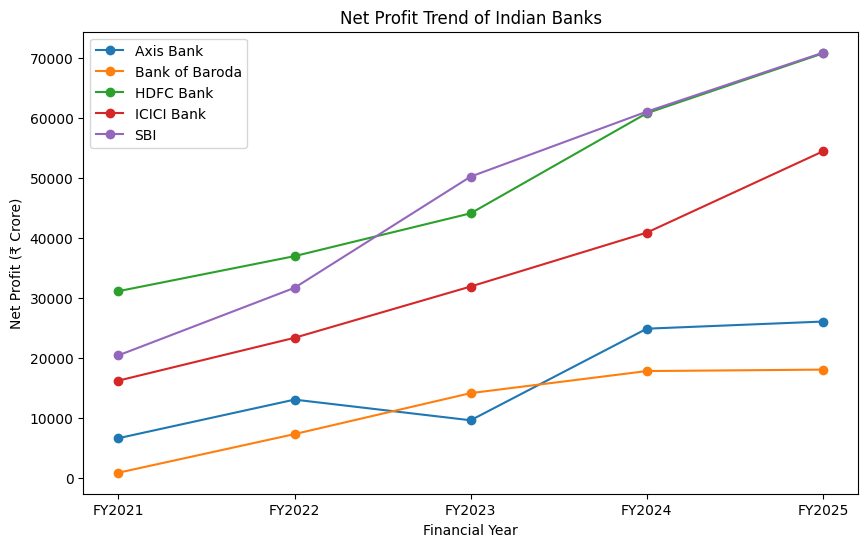
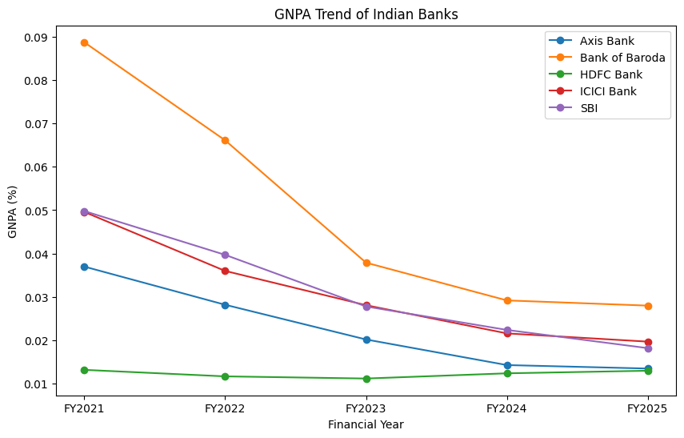
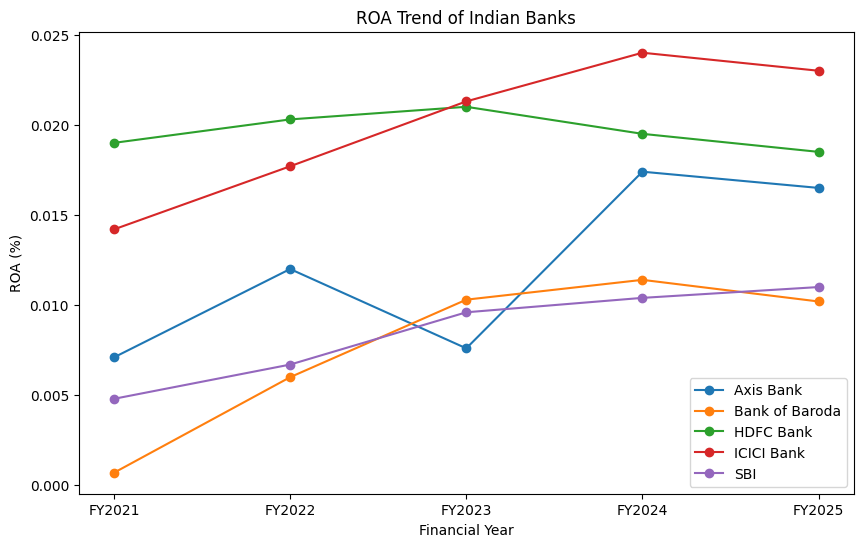
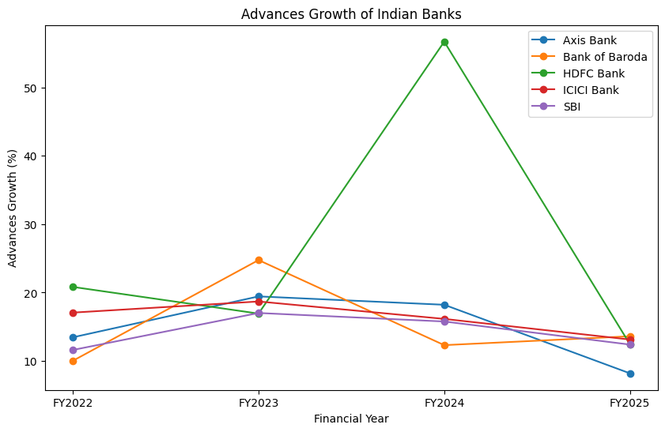
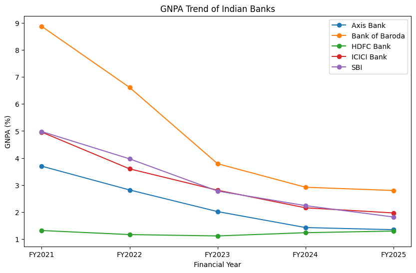
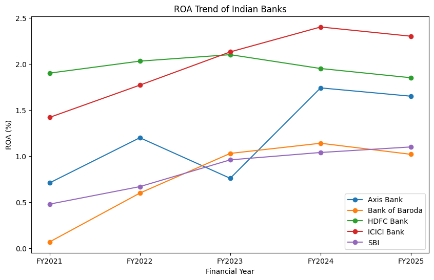
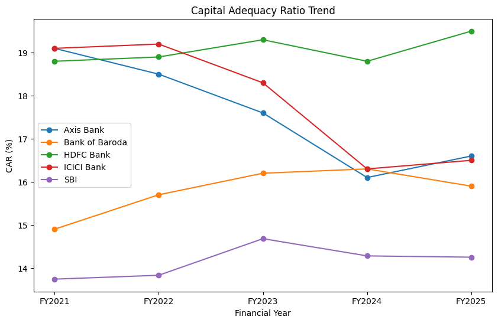
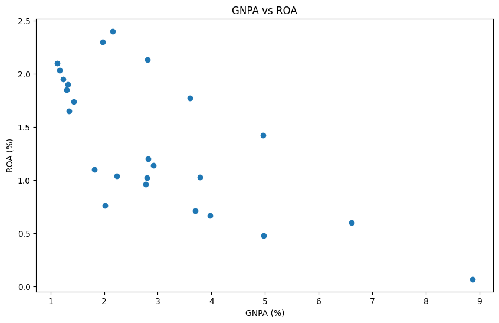
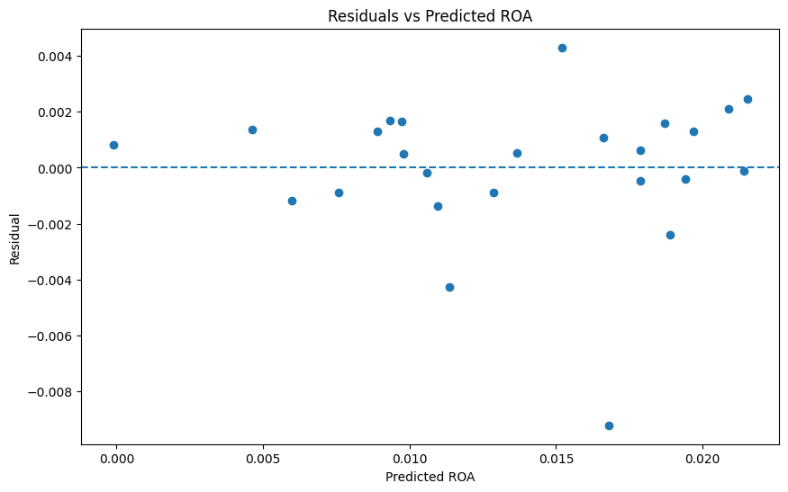
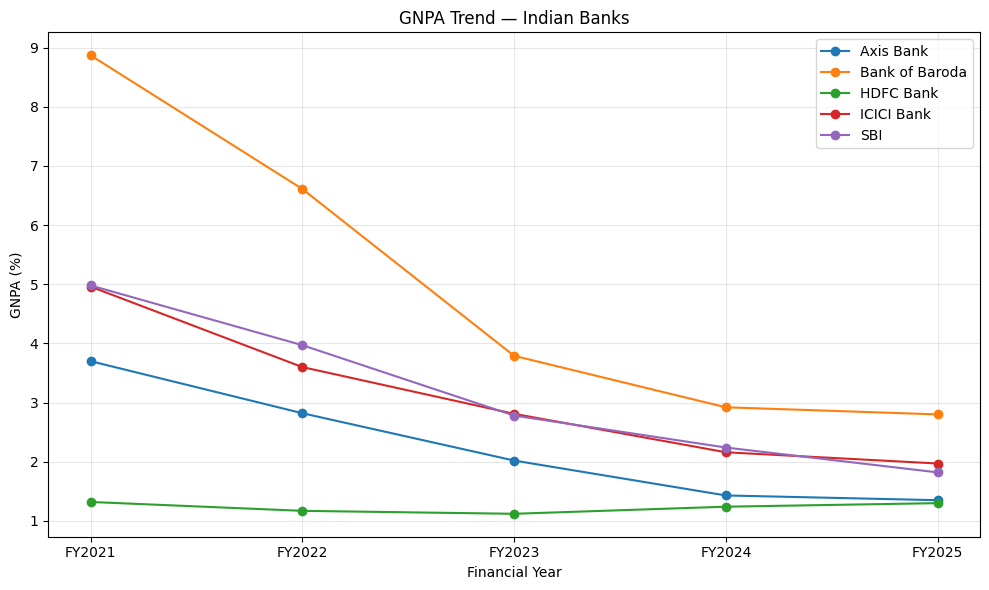

# Indian Banking Financial & Risk Analysis (FY2021–FY2025)

## 📌 Project Overview
An end-to-end financial performance, econometric validation, and credit risk assessment project evaluating the 5-year trajectory (**FY2021–FY2025**) of five major Indian banks: **State Bank of India (SBI), HDFC Bank, ICICI Bank, Axis Bank, and Bank of Baroda**[cite: 2, 12].

The workflow integrates exploratory data analysis, financial ratio engineering, OLS regression diagnostics, and multi-factor risk scoring in **Python**, relational storage in **SQLite**, and interactive executive reporting in **Microsoft Power BI**[cite: 1, 2, 3, 12].

---

## 📂 Repository Structure
* **`Project_1_Banking_Data.xlsx`** – Raw 5-year financial dataset (FY2021–FY2025) covering Deposits, Advances, Total Assets, Net Profit, ROA, ROE, GNPA, NNPA, CAR, NIM, Provision Coverage Ratio, and Cost/Income Ratio[cite: 2, 11].
* **`Project_1_Banking_Analysis.ipynb`** – Complete Jupyter Notebook containing EDA, YoY growth trends, correlation analysis, OLS regression diagnostics (VIF, Breusch-Pagan, Jarque-Bera, Durbin-Watson), composite risk scoring, and 18 visualizations[cite: 2, 11, 12].
* **`final_banking_dataset.csv` & `banking_analysis.xlsx`** – Processed datasets enriched with engineered financial ratios, period-over-period changes, and risk metrics[cite: 11].
* **`project_1_banking.db`** – SQLite database (`bank_data` table) storing the final scored dataset (`GNPA_Risk`, `NNPA_Risk`, `ROA_Risk`, `CAR_Risk`, and `Risk_Score`)[cite: 1, 11].
* **`Banking_Analysis_Dashboard.pbix`** – Interactive 4-page Power BI executive dashboard for visual benchmarking across banks and financial years[cite: 3, 11].
* **`images/`** – Folder containing all **18 exported Matplotlib plots** covering growth trajectories, asset quality, capital adequacy, OLS residual diagnostics, and banking risk scorecards[cite: 12].

---

## 📈 All 18 Visuals & Charts

### Part 1: Initial Trend Exploration (Step 9)
| SBI Net Profit Trend | Net Profit Comparison |
| :---: | :---: |
|  |  |

| GNPA Trend (Raw Scale) | ROA Trend (Raw Scale) |
| :---: | :---: |
|  |  |

---

### Part 2: Comparative Growth, Solvency & Asset Quality (Step 12)
| Net Profit Trend | Advances Growth (%) |
| :---: | :---: |
|  |  |

| GNPA Trend | ROA Trend |
| :---: | :---: |
|  |  |

| Capital Adequacy Ratio (CAR) Trend | GNPA vs. ROA Scatter |
| :---: | :---: |
|  |  |

---

### Part 3: Econometric Regression Diagnostics (Step 19)
| OLS Residuals vs. Predicted ROA |
| :---: |
|  |

---

### Part 4: Final Banking Risk Dashboard Charts (Step 23)
| Net Profit Trend (Styled) | GNPA Trend (%) |
| :---: | :---: |
|  |  |

| ROA Trend (%) | Capital Adequacy Ratio (%) |
| :---: | :---: |
| ![Final ROA Trend](images/chart_14_cell1
