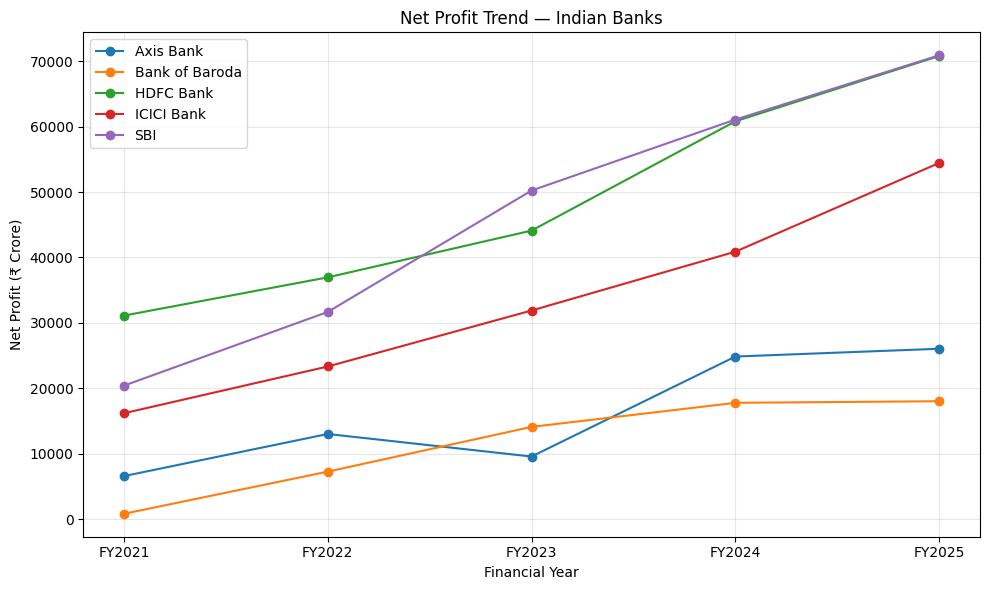
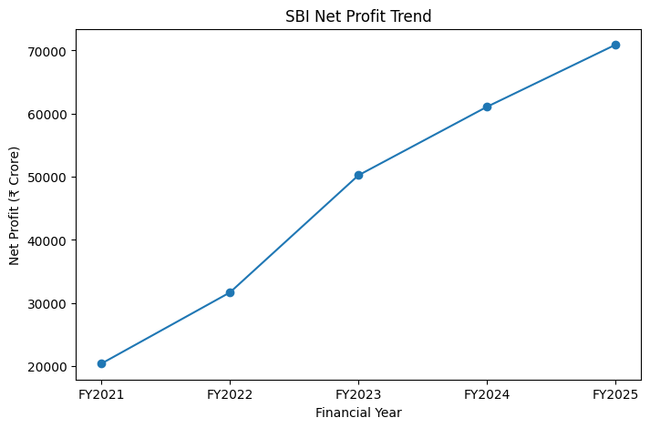
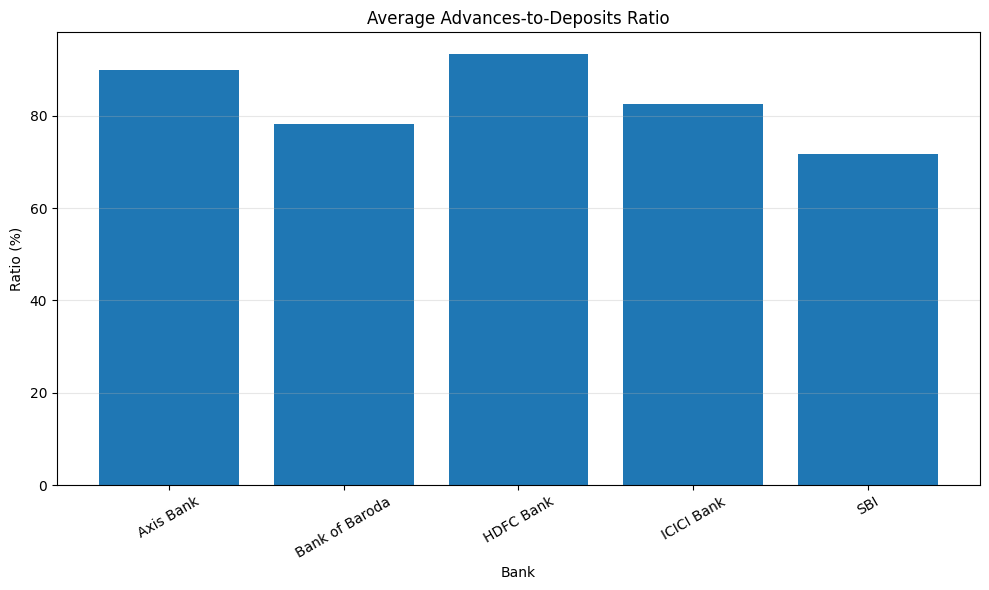
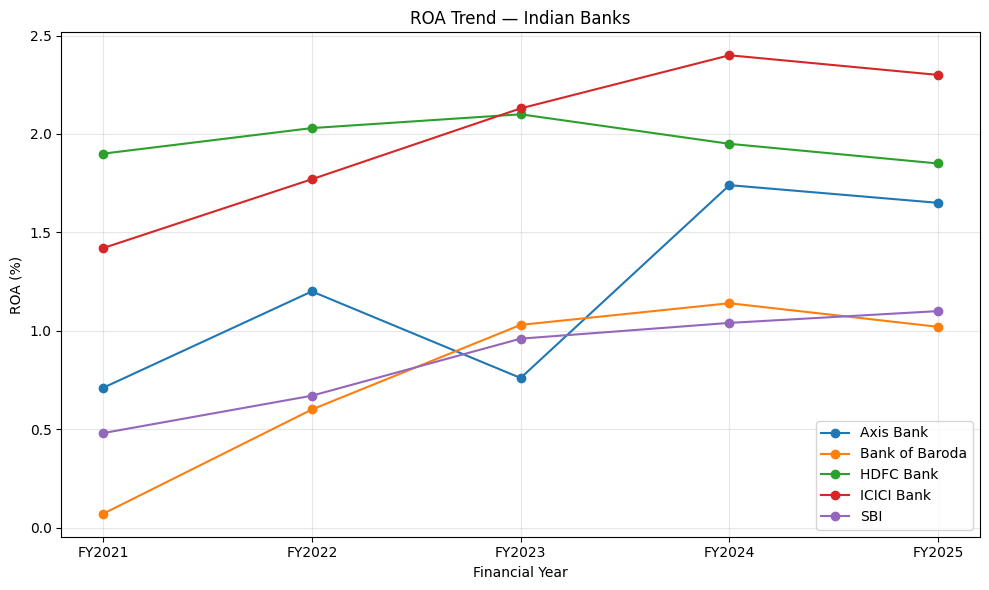
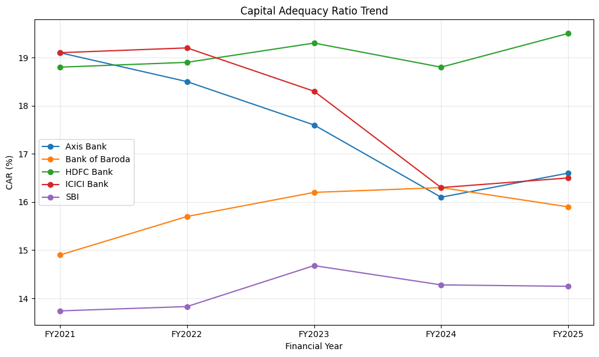
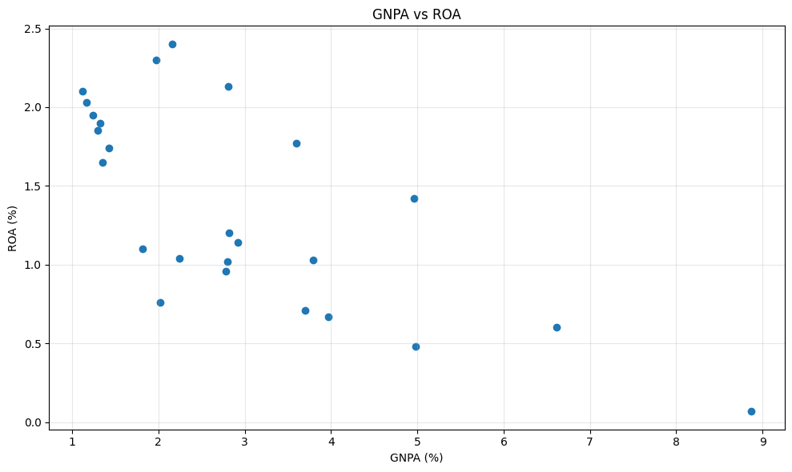
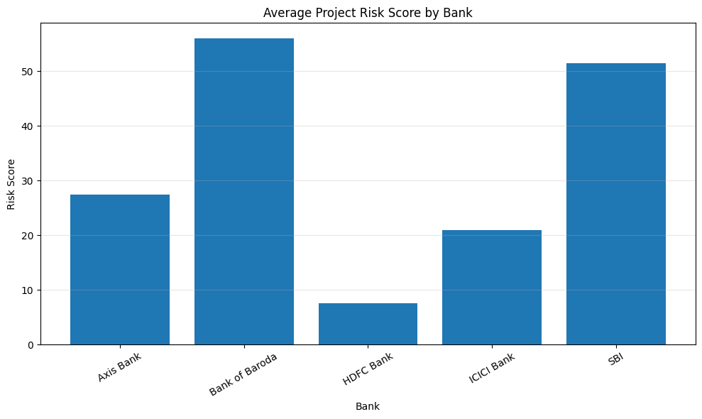

# Indian Banking Financial & Risk Analysis (FY2021–FY2025)

## 📌 Project Overview
An end-to-end financial performance, econometric validation, and credit risk assessment project evaluating the 5-year trajectory (**FY2021–FY2025**) of five major Indian banks: **State Bank of India (SBI), HDFC Bank, ICICI Bank, Axis Bank, and Bank of Baroda**[cite: 2, 12].

The workflow integrates exploratory data analysis, financial ratio engineering, OLS regression diagnostics, and multi-factor risk scoring in **Python**, relational storage in **SQLite**, and interactive executive reporting in **Microsoft Power BI**[cite: 1, 2, 3, 12].

---

## 📂 Repository Structure
* **`Project_1_Banking_Data.xlsx`** – Raw 5-year financial dataset (FY2021–FY2025) covering Deposits, Advances, Total Assets, Net Profit, ROA, ROE, GNPA, NNPA, CAR, NIM, Provision Coverage Ratio, and Cost/Income Ratio.
* **`Project_1_Banking_Analysis.ipynb`** – Complete Jupyter Notebook containing EDA, YoY growth trends, correlation analysis, OLS regression diagnostics (VIF, Breusch-Pagan, Jarque-Bera, Durbin-Watson), composite risk scoring, and 18 visualizations[cite: 2, 11, 12].
* **`final_banking_dataset.csv` & `banking_analysis.xlsx`** – Processed datasets enriched with engineered financial ratios, period-over-period changes, and risk metrics[cite: 11].
* **`project_1_banking.db`** – SQLite database (`bank_data` table) storing the final scored dataset (`GNPA_Risk`, `NNPA_Risk`, `ROA_Risk`, `CAR_Risk`, and `Risk_Score`)[cite: 1, 11].
* **`Banking_Analysis_Dashboard.pbix`** – Interactive 4-page Power BI executive dashboard for visual benchmarking across banks and financial years.
* **`images/`** – Folder containing all **18 exported Matplotlib plots** covering growth trajectories, asset quality, capital adequacy, OLS residual diagnostics, and banking risk scorecards[cite: 12].

---

## 📈 Visual Highlights

### 1. Profitability & Balance Sheet Growth (FY2021–FY2025)
| Net Profit Comparison | SBI Net Profit Trajectory |
| :---: | :---: |
|  |  |

| Advances Growth (%) | Average Advances-to-Deposits Ratio |
| :---: | :---: |
|  |  |

### 2. Asset Quality, Solvency & Returns
| Gross NPA (GNPA) Reduction | Return on Assets (ROA) Trend |
| :---: | :---: |
|  |  |

| Capital Adequacy Ratio (CAR) | GNPA vs. ROA Relationship |
| :---: | :---: |
|  |  |

### 3. Composite Risk Scorecard & Econometric Diagnostics
| Average Composite Risk Score by Bank | OLS Residuals vs. Predicted ROA |
| :---: | :---: |
|  |  |

*(All 18 high-resolution charts are available inside the `images/` folder[cite: 12].)*

---

## 📊 Financial & Risk Framework
* **Growth & Scale Metrics:** Year-over-Year (YoY) and 5-year cumulative growth across Net Profit, Deposits, Advances, and Total Assets[cite: 2].
* **Profitability & Efficiency:** Return on Assets (ROA), Return on Equity (ROE), Net Interest Margin (NIM), Cost-to-Income Ratio, and Profit-to-Advances Ratio[cite: 2].
* **Liquidity & Solvency:** Advances-to-Deposits Ratio (CDR) and Capital Adequacy Ratio (CAR)[cite: 2].
* **Econometric Validation:** Multiple OLS regression modeling ROA against GNPA, CAR, and NIM, validated via Variance Inflation Factor (VIF), Breusch-Pagan heteroscedasticity test, Jarque-Bera normality test, and Durbin-Watson autocorrelation diagnostics.
* **Composite Risk Scoring:** Min-max normalized risk indicators (`GNPA_Risk`, `NNPA_Risk`, `ROA_Risk`, `CAR_Risk`) combined into an equal-weighted **`Risk_Score`** per bank and financial year[cite: 1].

---

## 🔍 Key Analytical Insights (FY2021–FY2025)
1. **Sector-Wide Asset Quality Turnaround:** All five banks substantially reduced Gross NPAs over the 5-year period[cite: 2]. **Bank of Baroda** recorded the sharpest turnaround, lowering GNPA by **6.07 percentage points** (from **8.87%** in FY2021 to **2.80%** in FY2025)[cite: 2].
2. **Profitability Leaders:** **ICICI Bank** achieved the highest 5-year average ROA (**2.00%**) and ROE (**16.26%**), scaling Net Profit by **236.3%** (from ₹16,193 Cr to ₹54,449 Cr)[cite: 2].
3. **Scale vs. Expansion:** **SBI** maintained the largest balance sheet (**₹66.76 Lakh Cr** in Total Assets in FY2025) with **247.4%** net profit growth, while **HDFC Bank** recorded the fastest cumulative expansion in Advances (**+148.9%**) and Deposits (**+103.0%**)[cite: 2].
4. **Asset Quality Drives Profitability:** A strong inverse correlation (**-0.71**) between GNPA and ROA confirms that balance sheet cleanup directly fueled sector-wide return recovery[cite: 2].

---

## 🛠️ Tech Stack
* **Python:** `pandas`, `matplotlib`, `numpy`, `statsmodels`, `openpyxl`, `sqlite3`
* **Database:** SQLite (`project_1_banking.db`)[cite: 1, 11]
* **Business Intelligence:** Microsoft Power BI (`Banking_Analysis_Dashboard.pbix`)[cite: 3, 11]
* **Environment:** Jupyter Notebook[cite: 2]

---

## 🚀 How to Use This Project
1. **Clone the repository:**
   ```bash
   git clone [https://github.com/YOUR_USERNAME/indian-banking-financial-risk-analysis.git](https://github.com/YOUR_USERNAME/indian-banking-financial-risk-analysis.git)
