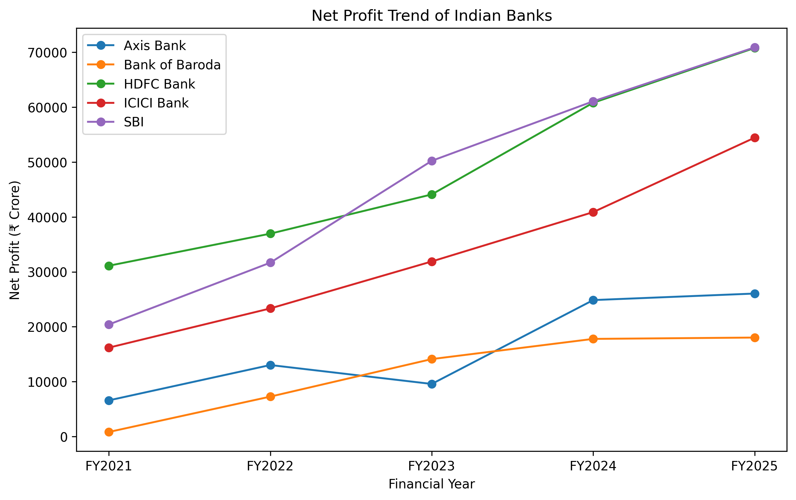
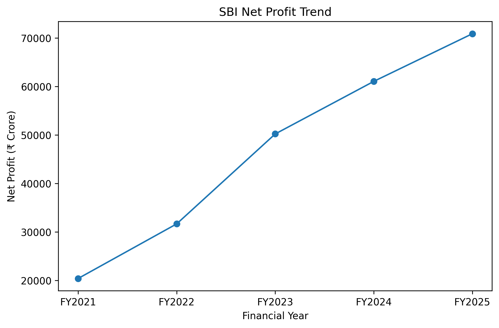

# Indian Banking Financial & Risk Analysis (FY2021–FY2025)

## 📌 Project Overview
An end-to-end financial performance and credit risk assessment project evaluating the 5-year trajectory (**FY2021–FY2025**) of five major Indian banks: **State Bank of India (SBI), HDFC Bank, ICICI Bank, Axis Bank, and Bank of Baroda**[cite: 2].

The pipeline integrates data cleaning, ratio engineering, and multi-factor risk scoring in **Python**, relational storage in **SQLite**, and interactive visual reporting in **Microsoft Power BI**[cite: 1, 2, 3].

---

## 📂 Repository Files
* **`Project_1_Banking_Data.xlsx`** – Raw 5-year financial dataset (FY2021–FY2025) containing Deposits, Advances, Total Assets, Net Profit, ROA, ROE, GNPA, NNPA, CAR, NIM, Provision Coverage Ratio, and Cost/Income Ratio.
* **`Project_1_Banking_Analysis.ipynb`** – Jupyter Notebook covering exploratory data analysis, YoY and 5-year cumulative growth trends, banking risk ratios, correlation analysis, and Matplotlib visualizations[cite: 2, 11].
* **`final_banking_dataset.csv` & `banking_analysis.xlsx`** – Final processed datasets enriched with engineered financial ratios, period-over-period changes, and composite risk metrics[cite: 11].
* **`project_1_banking.db`** – SQLite database (`bank_data` table) storing the final dataset along with granular and composite risk scores (`GNPA_Risk`, `NNPA_Risk`, `ROA_Risk`, `CAR_Risk`, and `Risk_Score`)[cite: 1, 11].
* **`Banking_Analysis_Dashboard.pbix`** – Interactive 4-page Power BI executive dashboard for visual benchmarking of growth, profitability, asset quality, and risk.
* **`net_profit_comparison.png` & `sbi_net_profit_trend.png`** – Exported Matplotlib trend visualizations[cite: 11].

---

## 📈 Visual Highlights

### Net Profit Comparison Across Top 5 Indian Banks (FY2021–FY2025)


### SBI Net Profit Trajectory (FY2021–FY2025)


---

## 🔍 Key Analytical Insights (FY2021–FY2025)
1. **Sector-Wide Asset Quality Turnaround:** All five banks substantially reduced Gross NPAs over the 5-year period[cite: 2]. **Bank of Baroda** recorded the sharpest turnaround, lowering GNPA by **6.07 percentage points** (from **8.87%** in FY2021 to **2.80%** in FY2025)[cite: 2].
2. **Profitability Leaders:** **ICICI Bank** achieved the highest 5-year average ROA (**2.00%**) and ROE (**16.26%**), scaling Net Profit by **236.3%** (from ₹16,193 Cr to ₹54,449 Cr)[cite: 2].
3. **Scale vs. Expansion:** **SBI** maintained the largest balance sheet (**₹66.76 Lakh Cr** in Total Assets in FY2025) with **247.4%** net profit growth, while **HDFC Bank** recorded the fastest cumulative expansion in Advances (**+148.9%**) and Deposits (**+103.0%**)[cite: 2].
4. **Asset Quality Drives Profitability:** A strong negative correlation (**-0.71**) between GNPA and ROA demonstrates how balance sheet cleanup directly fueled sector-wide return recovery[cite: 2].

---

## 🛠️ Tech Stack
* **Python:** `pandas`, `matplotlib`, `openpyxl`, `sqlite3`
* **Database:** SQLite (`project_1_banking.db`)[cite: 1, 11]
* **Business Intelligence:** Microsoft Power BI (`Banking_Analysis_Dashboard.pbix`)[cite: 3, 11]
* **Environment:** Jupyter Notebook[cite: 2]

---

## 🚀 How to Use This Project
1. **Clone the repository:**
   ```bash
   git clone [https://github.com/YOUR_USERNAME/indian-banking-financial-risk-analysis.git](https://github.com/YOUR_USERNAME/indian-banking-financial-risk-analysis.git)
